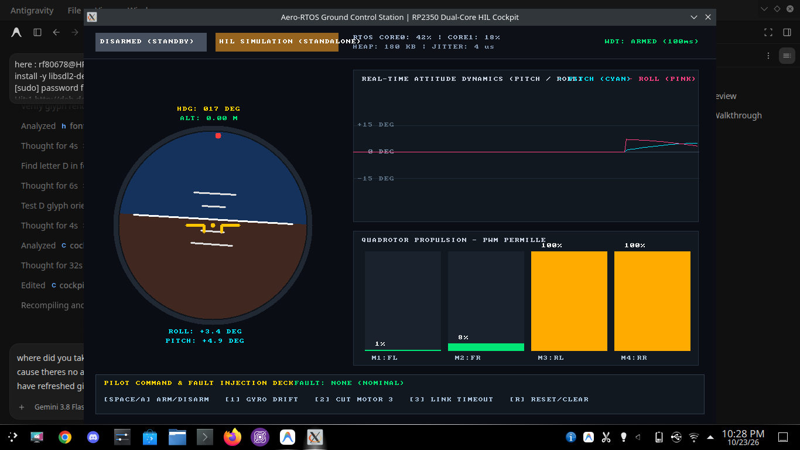

# Aero-RTOS HIL Autopilot & Telemetry Ground Station

An industrial-grade **Hardware-in-the-Loop (HIL)** flight dynamics supervisor and flight control computer running baremetal dual-core code on the Raspberry Pi Pico 2 W (**RP2350 Dual ARM Cortex-M33 @ 150 MHz**), interfaced via USB CDC to a real-time **SDL2 Primary Flight Display (PFD)** and diagnostic ground station running on Linux.



---

## Architecture Overview

```
+-----------------------------------------------------------------------------------------+
|                               PICO 2 W (RP2350 Baremetal C)                             |
|                                                                                         |
|  [CORE 0: Deterministic Dynamics & Control]    [CORE 1: Safety & Telemetry Broker]       |
|  * High-Frequency Task (500 Hz / 2.0 ms):       * Asynchronous Task (100 Hz / 10.0 ms):  |
|    - 6-DOF Dynamic Equations of Motion           - USB CDC Packet Framer (CRC16-CCITT)  |
|    - Cascaded PID Attitude & Velocity Loop       - Hardware Watchdog Timer (500 ms)     |
|    - Deterministic Safety State Machine:         - Fault Injection Engine (Simulate     |
|      STANDBY -> ARMED -> FLIGHT -> FAILSAFE        sensor drift, motor cutoff)          |
|                                                                                         |
|                     <==== Inter-Core Shared Memory & Zero-Copy Structs ====>            |
+-----------------------------------------------------------------------------------------+
                                          |
                              High-Speed USB CDC Serial
                                          |
+-----------------------------------------------------------------------------------------+
|                                DEBIAN LINUX LAPTOP                                      |
|                                                                                         |
|  [Desktop Window: SDL2 Hardware-Accelerated Ground Control Station]                     |
|  * Primary Flight Display (PFD): Artificial Horizon, Pitch Ladder, Heading & Alt Tapes |
|  * Multi-channel strip chart: Real-time 60 FPS scrolling waveforms (Pitch / Roll)      |
|  * 4-Channel Propulsion HUD: Motor PWM permille gauges with overload & cutout alerts   |
|  * Interactive Pilot Deck: Live ARM/DISARM and Hardware Fault Injection Hotkeys        |
+-----------------------------------------------------------------------------------------+
```

---

## Key Engineering Features

- **Dual-Core Asymmetric Processing (RP2350 Cortex-M33):**
  - **Core 0 (500 Hz):** Dedicated to deterministic numerical integration (6-DOF Euler kinematics, aerodynamic drag, motor thrust mixing) and cascaded PID loop calculation with anti-windup clamping and derivative low-pass filtering.
  - **Core 1 (100 Hz):** Dedicated to asynchronous I/O, binary packet framing (`0xAA 0x55` sync words + CRC16-CCITT), background telemetry streaming, command ingestion, and hardware watchdog servicing.
- **Hardware-in-the-Loop (HIL) Simulation:**
  - Evaluates autopilot firmware behavior against a real-time mathematical vehicle model directly on the microcontroller, simulating sensor drift and ESC cutouts without requiring physical airframes.
- **Deterministic Safety State Machine:**
  - `STATE_STANDBY_DISARMED` &rarr; `STATE_ARMED` &rarr; `STATE_FLIGHT_NORMAL` &rarr; `STATE_FAILSAFE_ACTIVE` &rarr; `STATE_EMERGENCY_KILL`.
  - Automatically commands a controlled descent upon excessive bank angle (>40°) or loss of telemetry link, and performs hard motor cutoff upon severe tumble (>75°).
- **High-Performance Desktop Cockpit (SDL2 / Linux):**
  - Native 60 FPS hardware-accelerated ground control station.
  - Self-contained embedded 8x8 font rendering with zero runtime font dependencies.
  - Multi-threaded asynchronous serial bridge with non-blocking POSIX termios read thread.
  - Built-in fallback dynamic simulation allowing the desktop cockpit to run seamlessly with or without physical hardware plugged in.

---

## Repository Structure

```
pico-hil-autopilot/
├── build_firmware.sh          # One-click build script for RP2350 .uf2 firmware
├── run_ground_station.sh       # One-click launch script for desktop Ground Station
├── docs/                      # Screenshots, architecture diagrams, and protocol specs
│   └── cockpit_screenshot.png
├── firmware/                  # RP2350 Pico 2 W baremetal C firmware
│   ├── CMakeLists.txt
│   ├── include/
│   │   ├── protocol.h         # Zero-copy binary packet definitions & CRC16-CCITT
│   │   ├── state_machine.h    # Safety state machine definitions & thresholds
│   │   ├── pid_controller.h   # Anti-windup PID controller with derivative filter
│   │   ├── physics_sim.h      # 6-DOF dynamic equations of motion
│   │   └── hil_engine.h       # Closed-loop HIL coordinator
│   └── src/
│       ├── main.c             # RP2350 multicore launch & watchdog init
│       ├── state_machine.c    # Deterministic state transitions
│       ├── pid_controller.c   # Cascaded PID loop implementation
│       ├── physics_sim.c      # 6-DOF numerical physics solver
│       └── hil_engine.c       # Control mixing & telemetry publisher
└── ground_station/            # Linux desktop ground control station (SDL2 C)
    ├── CMakeLists.txt
    ├── include/
    │   ├── cockpit.h          # PFD horizon, charts, gauges, and state structs
    │   ├── font8x8_basic.h    # Embedded 8x8 monochrome bitmap font
    │   ├── protocol.h         # Synced binary protocol header
    │   └── serial_bridge.h    # POSIX non-blocking serial reader thread
    └── src/
        ├── main.c             # SDL2 window loop & hotkey handler
        ├── cockpit.c          # Primary Flight Display & HUD rendering
        └── serial_bridge.c    # Serial framing & CRC validation thread
```

---

## Quickstart & Building

### 1. Prerequisites (Debian / Ubuntu)

```bash
sudo apt update && sudo apt install -y build-essential cmake libsdl2-dev gcc-arm-none-eabi libnewlib-arm-none-eabi
```

### 2. Launch the Desktop Ground Station

```bash
./run_ground_station.sh
```

**Controls:**
- **`[SPACE]`** or **`[A]`** &rarr; Toggle **ARM / DISARM**
- **`[1]`** &rarr; Inject **Gyro Bias / Drift** (triggers attitude deviation & failsafe)
- **`[2]`** &rarr; Inject **Motor 3 Cutout** (simulates ESC burnout)
- **`[3]`** &rarr; Inject **Link Timeout** (simulates telemetry loss)
- **`[R]`** &rarr; **Reset / Clear Faults** (returns to nominal flight)
- **`[ESC]`** &rarr; Exit

### 3. Compile the RP2350 Firmware (`.uf2`)

```bash
./build_firmware.sh
```

The resulting binary will be created at:
`firmware/build_rp2350/pico_hil_autopilot.uf2`

To flash onto the Pico 2 W:
1. Hold the **BOOTSEL** button on the Pico 2 W while plugging it into the USB port.
2. Copy the `.uf2` file to the mounted `RP2350` drive:
   ```bash
   cp firmware/build_rp2350/pico_hil_autopilot.uf2 /media/$USER/RP2350/
   ```
3. The Pico 2 W will automatically reboot and enumerate as `/dev/ttyACM0`. The Ground Station will automatically detect the hardware and bind to the live USB stream!

---

## License
MIT License
